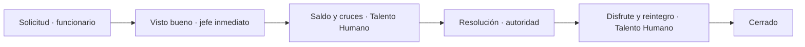

# Módulo de Vacaciones · Fase 1 (backend)

Estado al 7 de noviembre de 2026. Reemplaza el «Formato de Programación de vacaciones 2026.xls» de Talento Humano. Ese archivo contiene datos personales y **no se incorpora al repositorio** ni se usa en pruebas.

## Qué resuelve frente al formato en Excel

| Problema del formato actual | Comportamiento del sistema |
| --- | --- |
| La hoja «Fecha» solo tiene festivos de 2018–2020. En 6 de 10 filas de 2026 se otorgan 13 o 14 días hábiles en lugar de 15. | La fecha final se calcula con la tabla `Holiday`. Si un año no tiene festivos cargados, el cálculo se bloquea. |
| El periodo de causación está vacío en todas las filas. | Cada solicitud se asigna al periodo más antiguo con saldo, calculado desde la fecha de ingreso. |
| Cédulas repetidas entre personas distintas, encabezados de área copiados. | La cédula es única y el área es un registro (`Dependencia`) con su jefe. |
| Firma física del jefe y del servidor. | Visto bueno del jefe inmediato como etapa del expediente, con auditoría. |
| «Las vacaciones suspendidas deben programarse antes de un nuevo periodo». | Regla aplicada: los días pendientes del periodo más antiguo se programan primero. |

## Modelo de datos

- `Dependencia`: área con su `jefe`. Se crea automáticamente al registrar o editar un usuario con ese nombre de dependencia. La migración `0003` crea las dependencias a partir del texto de los perfiles existentes.
- `Profile`: nuevos campos `cedula` (única), `cargo`, `codigo`, `grado`, `hire_date` y `dependencia`. Se diligencian en **Usuarios y permisos**, junto con la casilla «Es jefe inmediato».
- `Holiday`: festivos. Se cargan con `python manage.py cargar_festivos 2026 2027`. El comando no sobrescribe festivos editados.
- `VacationPeriod`: un registro por año de servicio causado, con 15 días hábiles.
- `VacationLedgerEntry`: libro inmutable de días por periodo, con los movimientos `disfrute`, `devolucion` y `carga_inicial`. El saldo es `15 − disfrute − carga_inicial + devolucion`.

La lógica está en `core/vacations.py` (festivos, días hábiles, periodos, saldos, alertas) y en `core/services.py` (concesión, suspensión/aplazamiento, carga inicial, perfil).

## Flujo propuesto (expediente `vacaciones`)

- El funcionario indica **fecha de inicio** y **días hábiles**. El formulario propone los días disponibles del periodo más antiguo (máximo 15) y muestra, antes de guardar, el último día y la fecha de reintegro. El sistema asigna el periodo y calcula los días calendario.
- «Jefe inmediato» es un rol relacional, igual que `owner`: lo ejerce el jefe de la dependencia del funcionario. Si el solicitante es el propio jefe o el área no tiene jefe, actúa la autoridad competente. Nadie aprueba sus propias vacaciones.
- El jefe ve solo las vacaciones enviadas de su equipo, no sus incapacidades ni viáticos.
- Se bloquean los cruces con otras vacaciones, incapacidades, comisiones o compensatorios del mismo funcionario.
- Los días se descuentan al completar la etapa de resolución. Desde ese momento no se admite devolución; se usan las novedades.
- **Suspensión**: es la única novedad de vacaciones (ver «Reglas acordadas»). Solo la registra Talento Humano, con la resolución adjunta en el mismo formulario, una vez por cada salida. Los días no disfrutados vuelven al mismo periodo.
- **Carga inicial**: `services.register_initial_vacation_days(...)` registra los días ya disfrutados de periodos anteriores. Todavía no tiene pantalla.

## Reglas acordadas con Talento Humano (noviembre de 2026)

| Regla | Cómo la aplica el sistema |
| --- | --- |
| La única novedad es la **suspensión**. No existe «aplazar» ni «cancelar», porque las vacaciones son obligatorias. | Hay un solo botón: «Suspender vacaciones». |
| La primera salida de cada periodo es de **al menos 5 días hábiles**. | Si la primera solicitud del periodo tiene menos de 5 días, se rechaza con un mensaje claro. |
| Los días restantes se pueden tomar después, hasta completar los 15. | Las salidas siguientes del mismo periodo pueden ser de cualquier tamaño. |
| Solo se suspende **cuando las vacaciones ya empezaron** y se han disfrutado al menos 5 días hábiles del periodo. | El formulario indica desde qué fecha se puede suspender; antes de iniciar, el botón no aparece. |
| Se puede suspender **más de una vez**, dentro del año. | Cada salida admite una suspensión; los días devueltos se retoman en una nueva solicitud, que también se puede suspender. |
| Los días suspendidos se retoman **dentro del año**. | El plazo se cuenta desde el primer día de vacaciones del periodo. El sistema muestra la fecha límite en el historial y avisa en el panel 30 días antes o si ya venció. **No bloquea**, para que los días no queden perdidos en el sistema. |
| Cada novedad lleva **su acto administrativo**. | La suspensión exige el número, la fecha y el archivo de la resolución, en un solo paso. Si la suspensión no procede, el archivo tampoco se guarda. |
| El motivo es distinto en cada caso. | El motivo se escribe con texto libre. |

### Historial por funcionario

La página **Historial de vacaciones** (`/vacaciones/historial/<id>`) muestra, por periodo:
- lo que se disfrutó,
- cada suspensión con su resolución, su motivo y el enlace al documento,
- los días tomados antes del sistema,
- lo que queda y la fecha límite para tomarlo.

Sirve para verificar cuando alguien dice «me faltan 10 días».

- **Quién la puede ver:** el propio funcionario, su jefe, Talento Humano, la autoridad y Control Interno.
- **Cómo se llega:**
  - con «Mi historial de vacaciones», en la página de vacaciones;
  - con «Ver historial», en cada fila de «Saldos y festivos»;
  - con el enlace en el detalle de cada solicitud.

## Recordatorios en el panel

- Inicio de vacaciones en los próximos 15 días: para el funcionario, su jefe y Talento Humano.
- Reintegro en los próximos 3 días.
- 2 o más periodos acumulados con saldo.
- Periodo que prescribe en los próximos 180 días.
- Días pendientes cuyo plazo de un año vence en los próximos 30 días o ya venció.

Los umbrales están en `core/vacations.py`. No se envían correos.

## Supuestos por confirmar con Talento Humano

1. 15 días hábiles por periodo; sábado y domingo no hábiles (el formato lo confirma).
2. Prescripción a los 4 años de causado el periodo; los periodos prescritos no se asignan.
3. Se emite una resolución por solicitud, firmada por la autoridad.
4. ~~Diferencia entre «aplazada» y «suspendida»~~: resuelto, solo existe la suspensión.
5. Una solicitud no puede iniciar en sábado, domingo ni festivo.
6. Quién autoriza las vacaciones de la Contralora.
7. El festivo de Nuestra Señora del Rosario de Chiquinquirá se incluye desde 2026; verificar contra el calendario oficial.

## Pendiente para fases siguientes

- Plan anual por dependencia: el jefe o Talento Humano programan en nombre de los funcionarios.
- Calendario mensual por dependencia.
- Pantallas para festivos, carga inicial de saldos y jefes por dependencia.
- Formato imprimible para firma, reportes y correos de recordatorio.
